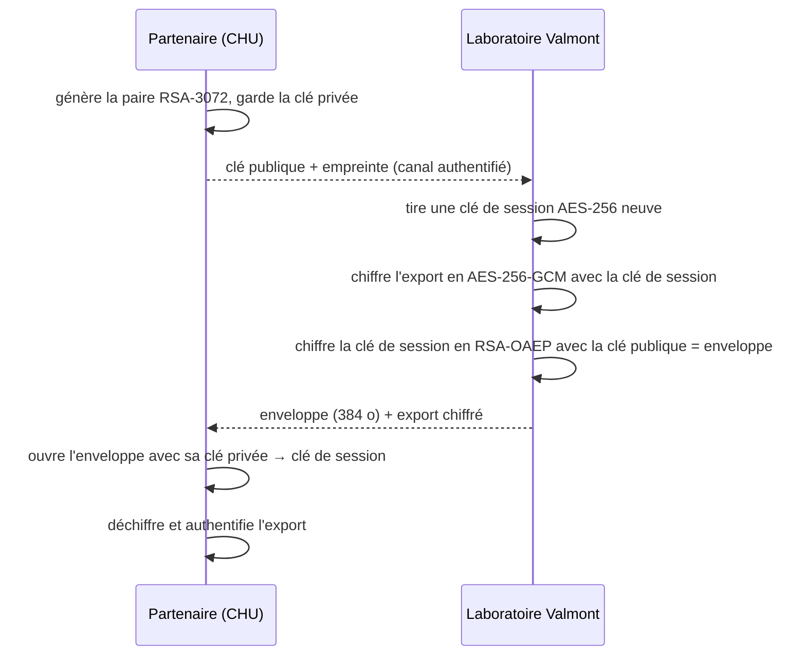

# Étape 3 — Transmettre une clé sans la livrer

*Chapitre 03 — échange hybride entre le Laboratoire Valmont et le centre hospitalier partenaire.*

## Ce que l'asymétrique résout là où le symétrique seul échoue

Avec le symétrique seul, le labo et le partenaire devraient d'abord partager la même clé
AES, donc la faire traverser un canal (courriel, clé USB, téléphone) où elle peut être
interceptée : c'est le problème de la distribution des clés. L'asymétrique le supprime :
le partenaire publie une clé publique que tout le monde peut connaître, le labo s'en sert
pour chiffrer la clé de session, et seule la clé privée, qui n'a jamais quitté le
partenaire, peut l'ouvrir. On garde le symétrique pour les données, car RSA est lent et
limité à quelques centaines d'octets : l'asymétrique transporte la clé, le symétrique
transporte le volume (principe hybride, le même que dans TLS).

## Schéma



## Contenu

| Fichier | Rôle |
| --- | --- |
| `echanger_cle.py` | `generer-partenaire` (côté CHU), `envelopper` (côté labo), `ouvrir` (côté CHU) |
| `test_echange.py` | 7 contrôles automatisés, en mémoire |
| `partenaire/partenaire_public.pem` | Clé publique RSA-3072 du partenaire, celle qu'on utilise pour chiffrer |
| `livraison/cle_session.enveloppe` | La clé de session chiffrée par RSA-OAEP : **l'enveloppe** |
| `livraison/export.csv.chiffre` | L'export du 5 novembre chiffré avec la clé de session |
| `preuves/03-echange-hybride.txt` | Sortie réelle : aller-retour, vérification croisée avec openssl, contrôles |

La clé privée du partenaire n'est **pas** livrée : elle n'existe que chez lui (exclue par
`.gitignore`). Pour rejouer la démonstration, on régénère une paire.

## Choix techniques

| Point | Choix | Pourquoi |
| --- | --- | --- |
| Asymétrique | RSA-3072, e = 65537 | ≥ 3072 bits recommandé par l'ANSSI pour une protection au-delà de 2030 |
| Remplissage | **OAEP** (SHA-256, MGF1-SHA-256) | PKCS#1 v1.5 en chiffrement est vulnérable à l'attaque de Bleichenbacher |
| Clé de session | 32 octets `os.urandom`, **neuve à chaque export** | Une fuite ne compromet qu'un seul export |
| Données | AES-256-GCM, nonce de 12 octets | AEAD : confidentialité et intégrité |
| Lien enveloppe ↔ fichier | AAD = libellé ‖ SHA-256(enveloppe) | Un fichier chiffré ne peut pas être recombiné avec l'enveloppe d'un autre jour |
| Clé privée du partenaire | PKCS#8 chiffré (`BestAvailableEncryption`), phrase de passe dans `VALMONT_PASSPHRASE_PARTENAIRE` | Le fichier `.pem` volé seul ne suffit pas |
| Clé publique | Empreinte SHA-256 affichée des deux côtés | Permet de vérifier qu'on chiffre bien pour le partenaire (voir limites) |

## Exécution (PowerShell, une commande à la fois)

```
cd "C:\Users\tirar\OneDrive\Documents\diginamic cours\La-cryptographie-support-de-cours\valmont-securite\03-echange-de-cle"
```

Choisir la phrase de passe du partenaire (simulé) :

```
$env:VALMONT_PASSPHRASE_PARTENAIRE = [System.Net.NetworkCredential]::new("", (Read-Host "Phrase de passe du partenaire" -AsSecureString)).Password
```

Côté partenaire, créer sa paire de clés :

```
py echanger_cle.py generer-partenaire partenaire
```

Côté labo, envelopper la clé de session et chiffrer l'export :

```
py echanger_cle.py envelopper ..\02-au-repos\donnees\export_2026-11-05.csv partenaire\partenaire_public.pem livraison
```

Côté partenaire, ouvrir :

```
py echanger_cle.py ouvrir livraison partenaire\partenaire_prive.pem export_recu.csv
```

Contrôles automatisés (résultat attendu : `Bilan : 7/7 contrôles réussis`) :

```
py test_echange.py ..\02-au-repos\donnees\export_2026-11-05.csv
```

Vérification indépendante avec openssl (installé avec Git for Windows) :

```
& "C:\Program Files\Git\usr\bin\openssl.exe" pkeyutl -decrypt -inkey partenaire\partenaire_prive.pem -passin env:VALMONT_PASSPHRASE_PARTENAIRE -pkeyopt rsa_padding_mode:oaep -pkeyopt rsa_oaep_md:sha256 -pkeyopt rsa_mgf1_md:sha256 -in livraison\cle_session.enveloppe -out cle_session.bin
```

```
& "C:\Program Files\Git\usr\bin\openssl.exe" dgst -sha256 cle_session.bin
```

Résultat attendu : la même empreinte que celle affichée par `envelopper` et `ouvrir`.
Supprimer ensuite `cle_session.bin`, qui contient la clé de session en clair.

## Limites (à reprendre dans le rapport)

- **L'authenticité de la clé publique.** Si un attaquant substitue sa propre clé publique
  à celle du partenaire, le labo chiffre pour l'attaquant. L'empreinte doit être
  confirmée par un canal authentifié (appel au RSSI du CHU, document signé) ou, mieux,
  la clé doit être portée par un **certificat** émis par une autorité de confiance
  (chapitre 08).
- **L'origine de l'export n'est pas prouvée.** N'importe qui possédant la clé publique
  peut fabriquer une enveloppe valide. La preuve d'origine vient de la **signature** du
  biologiste (étape 4).
- **Pas de confidentialité persistante.** Si la clé privée du partenaire fuit un jour,
  toutes les enveloppes archivées deviennent lisibles. Un échange **ECDH éphémère**
  (X25519, comme dans TLS 1.3) éviterait ce risque, mais demande que les deux parties
  soient en ligne au même moment, ce qui ne colle pas avec un dépôt nocturne. C'est un
  compromis assumé : rotation annuelle de la paire du partenaire (étape 5).
- **Post-quantique.** RSA ne résiste pas à un ordinateur quantique suffisant. Pour des
  données de santé à conserver longtemps, une encapsulation hybride (X25519 + ML-KEM)
  est à suivre (« récolter maintenant, déchiffrer plus tard »).
