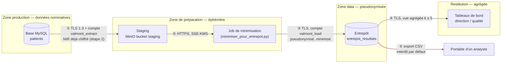

# Étape 7 — Trajet d'un résultat d'analyse, protection par tronçon, minimisation

*Chapitre 11 — Laboratoire Valmont. Chaque choix est justifié par un **risque**, pas par une habitude.*

## 1. Le trajet

Exemple suivi : la glycémie à jeun d'Alicie Marchand (CR-2026-1189), de la base jusqu'au
tableau de bord de la direction.

Les données nominatives ne quittent jamais la zone production : la minimisation se fait
**avant** l'entrepôt, dans la zone de préparation, dont les fichiers sont supprimés à la fin du job.

## 2. Mesure de protection par tronçon

| Tronçon | Ce qui circule | Risque si rien n'est fait | Mesure retenue | Justification par le risque |
| --- | --- | --- | --- | --- |
| **① Base → staging** | Fiches complètes : identité, coordonnées, NIR **chiffré**, résultats | Un observateur du réseau interne (machine compromise, prestataire de support) lit des données de santé nominatives | MySQL `require_secure_transport=ON` (le clair est **refusé**, pas déconseillé) ; compte `valmont_extract` en lecture seule sur les seules colonnes utiles ; mot de passe dynamique délivré par le Coffre | Le réseau interne n'est pas une zone de confiance (chapitre 11) ; un compte en lecture seule limite ce qu'une fuite d'identifiants permet |
| **Staging (au repos)** | Le même extrait, sous forme de fichier | Un fichier oublié dans un bucket est une copie complète, sans contrôle d'accès applicatif | Bucket dédié, chiffrement côté serveur **SSE-KMS** (clé K10) ; **cycle de vie : suppression automatique après 24 h** ; accès limité aux identités du job | La zone de préparation est le maillon le plus souvent oublié ; une règle de suppression automatique ne dépend pas de la discipline de quelqu'un |
| **② Staging → job de minimisation** | Fichier d'extraction | Interception ou altération du fichier avant traitement | Point d'entrée MinIO en **HTTPS uniquement**, certificat vérifié ; somme SHA-256 du fichier contrôlée avant traitement | Un fichier altéré produirait des statistiques fausses sans erreur visible |
| **③ Job → entrepôt** | Lignes **pseudonymisées et minimisées** (8 colonnes au lieu de 12) | L'entrepôt agrège tout, longtemps, pour beaucoup de monde | TLS vers l'entrepôt ; compte `valmont_load` en écriture seule ; **la clé de pseudonymisation (K12) reste hors de l'entrepôt** | Une fuite de l'entrepôt ne livre ni nom, ni NIR, ni coordonnées, et le jeton ne se recalcule pas sans K12 |
| **Entrepôt (au repos)** | Résultats pseudonymisés, sur des années | Analyste trop large, sauvegarde volée | Chiffrement du stockage ; accès par rôle ; **durée de conservation** appliquée par une purge automatique ; journal des requêtes | Les données restent **personnelles** (voir § 4) : le RGPD s'applique pleinement |
| **④ Entrepôt → tableaux de bord** | Agrégats | Une case « 1 patient, 70-79 ans, Grand Est, D-dimères » désigne une personne | Les outils de restitution ne voient qu'une **vue agrégée** ; cases **< 5 résultats masquées** ; HTTPS / TLS sur le connecteur BI | La direction a besoin de volumes et de tendances, pas de lignes individuelles |
| **⑤ Export CSV** | Ce que l'analyste extrait | Un CSV sur un portable sort de toute protection (chapitre 11 : « une fuite qui ne dit pas son nom ») | **Interdit par défaut** ; sur demande motivée : extrait agrégé, chiffré, tracé, avec une date de destruction | Le chiffrement de l'entrepôt ne protège plus rien une fois la table copiée |
| Export partenaire (CHU) | Comptes rendus nominatifs | Lecture chez un tiers ou en transit | Chiffrement hybride du fichier (étape 3) et signature (étape 4) | Le transport protège le trajet, le chiffrement du fichier protège le contenu chez le destinataire |

## 3. Ce qui ne doit **pas** être stocké ni exporté

| Donnée | Base de production | Entrepôt | Tableau de bord | Pourquoi (risque) |
| --- | --- | --- | --- | --- |
| Nom, prénom | Oui (relation patient) | **Non** | **Non** | Aucun traitement statistique n'en a besoin ; c'est l'identifiant le plus direct |
| E-mail, téléphone, adresse | Oui (envoi des résultats) | **Non** | **Non** | Identifiants directs ; l'adresse se réduit à la **région** |
| NIR | Oui, **chiffré** (étape 2) | **Non** → jeton HMAC | **Non** | Identifiant national unique, donnée sensible par excellence ; le jeton permet le suivi longitudinal sans lui |
| Date de naissance | Oui | **Non** → tranche de 10 ans | Tranche | La date exacte est un quasi-identifiant fort (avec le sexe et le lieu, elle isole la quasi-totalité des personnes) |
| Département | (dans l'adresse) | **Non** → région | Région | Mesuré : avec le département, 15 fiches sur 15 sont uniques |
| Horodatage exact du rendu | Oui | **Non** → mois | Mois | L'heure de passage au laboratoire peut se recouper avec d'autres sources |
| Mot de passe, sel, empreinte | Base portail uniquement | **Non** | **Non** | Aucune finalité analytique ; risque d'attaque hors ligne sur les empreintes |
| Nom du biologiste | Comptes rendus | Non nécessaire | Non | Donnée personnelle d'un salarié, hors finalité du reporting |
| Clés K1, K2, K12 | **Jamais en base** | **Jamais** | — | La clé qui protège une donnée ne vit pas à côté d'elle |

**Conservé dans l'entrepôt :** `pseudo_patient`, `sexe` (les valeurs de référence
biologiques en dépendent : hémoglobine, créatinine, ferritine), `tranche_age`, `region`,
`analyse`, `valeur`, `unite`, `mois_rendu`.

## 4. Ce que la mesure a montré (`minimiser_pour_entrepot.py`)

| Contrôle | Résultat |
| --- | --- |
| Identifiants directs retrouvés dans l'entrepôt (90 valeurs cherchées : NIR, noms, e-mails, téléphones, dates, adresses) | **0** |
| Jeton recalculable par `SHA-256(NIR)` sans la clé | **Non** : l'énumération des NIR ne sert à rien |
| k-anonymat (sexe, tranche d'âge, département) | **k = 1**, 15/15 lignes uniques : choix écarté |
| k-anonymat (sexe, tranche d'âge, région) | **k = 1**, 15/15 lignes uniques |
| Cases du tableau de bord ≥ 5 résultats | **0 / 15** : tout est masqué sur cet échantillon |

**Conclusion assumée : pseudonymiser n'est pas anonymiser.** Même minimisé, l'entrepôt
contient des données **personnelles de santé**. Le jeton est stable, et les
quasi-identifiants isolent encore les personnes. Le RGPD s'applique donc pleinement
(registre, accès restreint, durée de conservation, analyse d'impact). Seuls les
**agrégats masqués** des tableaux de bord peuvent prétendre ne plus désigner personne.
Sur 15 fiches, aucune case n'atteint le seuil, et rien ne serait publiable. C'est le bon
résultat : un tableau de bord sur 15 patients serait une liste de patients.

## 5. Durées de conservation

| Donnée | Durée | Mécanisme |
| --- | --- | --- |
| Zone de préparation (staging) | **24 h** | Règle de cycle de vie MinIO (suppression automatique) |
| Entrepôt (lignes pseudonymisées) | **À fixer avec le DPO**, au plus juste du besoin d'analyse (par exemple 5 ans glissants) | Purge mensuelle automatique, tracée |
| Agrégats des tableaux de bord | Sans limite technique, s'ils sont réellement anonymes (k ≥ 5) | — |
| Base de production | Selon les obligations légales de conservation des comptes rendus de biologie médicale, **à confirmer par le DPO** | Hors périmètre data |

Une durée écrite sans suppression automatique n'est qu'un vœu (chapitre 11) : chaque
ligne de ce tableau a son mécanisme.
